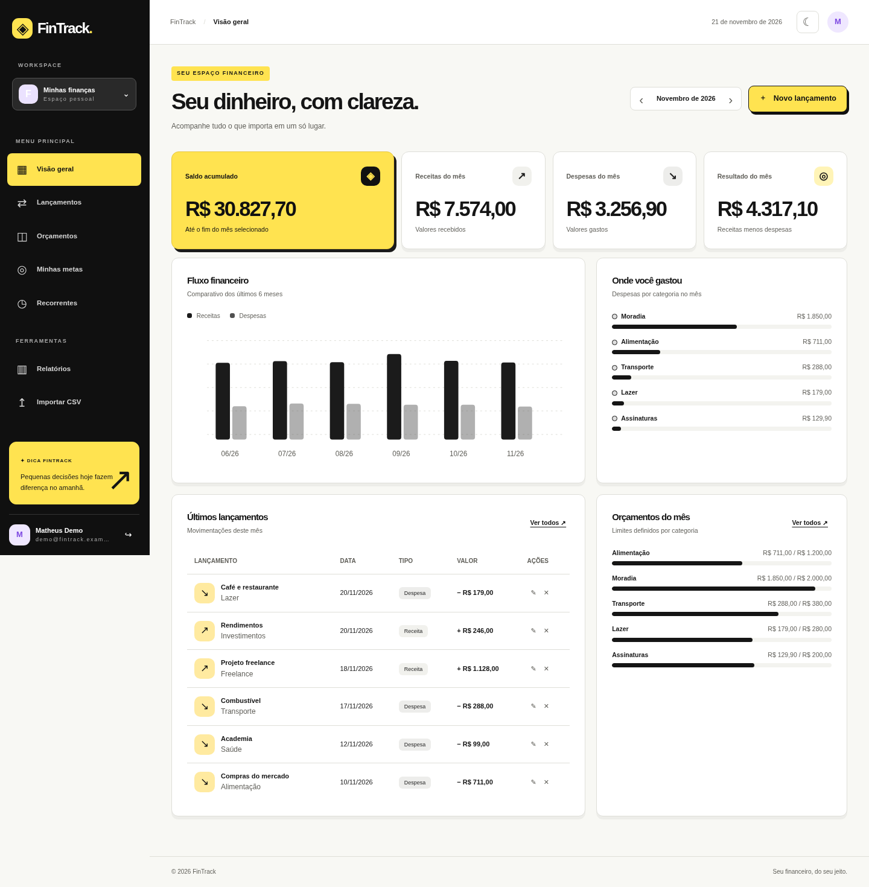
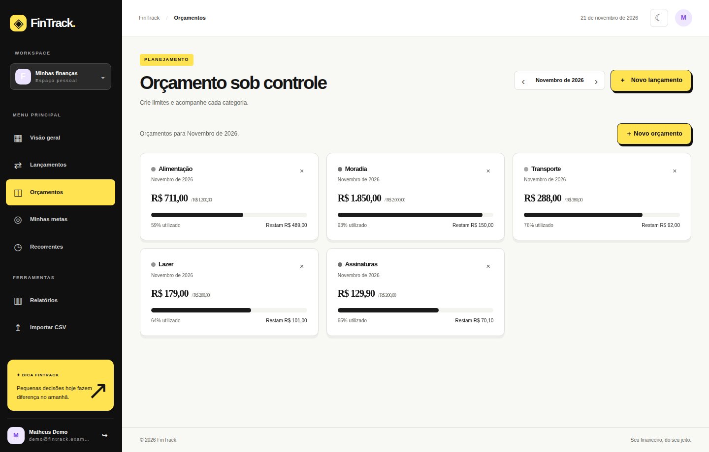
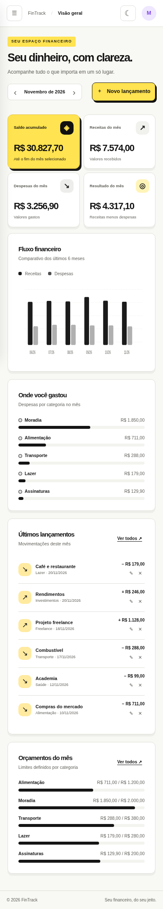
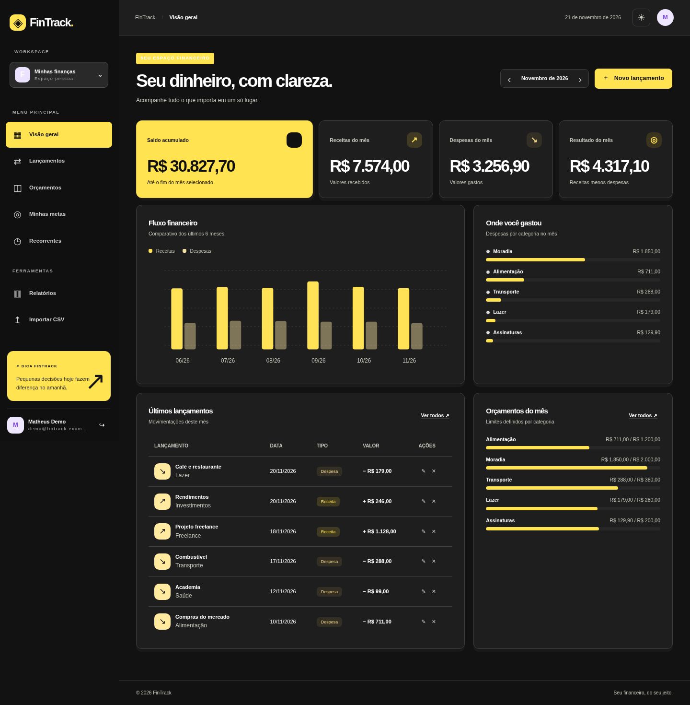
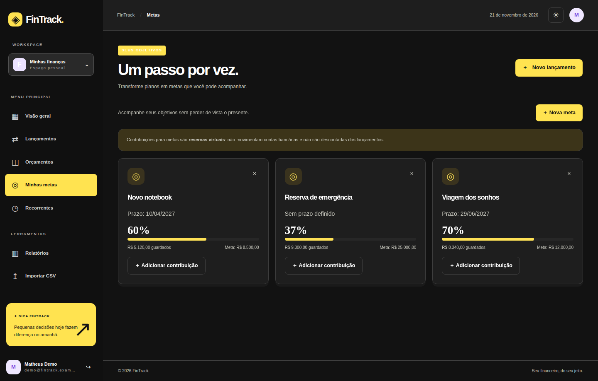

<div align="center">

# FinTrack

**Organize receitas, despesas, orçamentos e metas financeiras.**


**[Perfil no GitHub](https://github.com/tteukkkk)** · **[Screenshots](#capturas-do-projeto)** · **[Como executar](#como-executar)**

<a href="previews/painel-claro.png"></a>

</div>

> **Status:** v1.0 · demonstração funcional local; não homologado para dados bancários reais. Dados e contas de demonstração são fictícios. O repositório apresenta um aplicativo local, não um serviço publicado na internet.

## Capturas do projeto

| Funcionalidade | Versão mobile |
| :---: | :---: |
|  |  |

As demais telas (landing page, painel, relatórios, configurações e outras) estão em [`previews/`](previews/).

## Como executar

A seção técnica abaixo contém pré-requisitos, instalação, inicialização, testes e observações de segurança. Para uma instalação mais simples no Windows, consulte também as instruções de cada projeto.

---


**FinTrack** é um aplicativo de organização financeira desenvolvido para o portfólio de **Matheus Macêdo Felicio**. A plataforma combina interface amarela, preta e branca com modo claro/escuro, API Python, banco relacional e funcionalidades reais de controle financeiro.

> **Estado:** versão **1.0**, funcional e validada em ambiente local com dados de demonstração. É um projeto de portfólio, **não um serviço financeiro homologado**. Não conecte contas bancárias nem use dados sensíveis de terceiros sem preparação operacional e revisão de segurança.

## Prévia

| Painel claro | Painel escuro |
| --- | --- |
|  |  |

| Orçamentos | Metas |
| --- | --- |
|  |  |

Outras imagens: landing page, tela de login, lançamentos, recorrências, importação CSV, relatórios, configurações e interface móvel, disponíveis em `previews/`.

As capturas usam os **HTML/CSS/JavaScript reais** e respostas obtidas da API FastAPI de demonstração. O Chromium do ambiente de captura bloqueou navegação HTTP local; por isso, as respostas foram fornecidas ao navegador em modo offline. O frontend também foi testado com ações reais via ponte para o FastAPI TestClient. As imagens **não** são capturas de uma hospedagem online.

## Funcionalidades

- **Acesso e privacidade:** cadastro, login, senha com hash Argon2, sessão no servidor com cookie HttpOnly, proteção CSRF e limite inicial de tentativas incorretas.
- **Espaços separados:** cada usuário pode criar e alternar entre espaços financeiros isolados, com categorias e dados próprios.
- **Lançamentos:** cadastrar, editar, excluir, pesquisar e filtrar receitas e despesas por mês, tipo e categoria; navegação paginada.
- **Dashboard:** saldo acumulado, receitas, despesas, resultado mensal, séries dos últimos seis meses e categorias com maiores gastos.
- **Orçamentos:** limites por categoria/mês, consumo percentual e alertas visuais quando há excesso.
- **Metas:** objetivos com prazo, valor-alvo, contribuições e progresso. **Contribuições são virtuais:** não transferem dinheiro nem debitam o saldo.
- **Recorrências:** regras semanais e mensais, pausa/ativação, criação **manual** de lançamentos vencidos, sem duplicações por execução repetida.
- **Importação CSV:** revisão antecipada, validação, limite de tamanho, mapeamento de categorias e identificação de duplicações.
- **Exportação CSV:** extrato por período com neutralização de células que poderiam ser interpretadas como fórmulas.
- **Relatórios:** resumo por período, evolução por mês e gastos por categoria.
- **Configurações:** nome do espaço, categorias personalizadas, troca de workspace, atividade e preferência de tema.
- **Interface:** responsiva, com transições, foco visível e suporte a `prefers-reduced-motion`; sem biblioteca de gráficos externa.

## Tecnologias

**Backend:** Python 3.12+, FastAPI, SQLAlchemy 2, Argon2. **Banco:** SQLite para demonstração; conexão configurável com PostgreSQL. **Frontend:** HTML semântico, CSS e JavaScript sem frameworks; gráficos com SVG. **Qualidade:** pytest, FastAPI TestClient e teste de interface opcional com Playwright.

## Como executar no computador

Na pasta `FinTrack`, crie um ambiente virtual:

```bash
python -m venv .venv
```

Ative o ambiente:

```powershell
# Windows / PowerShell
.venv\Scripts\Activate.ps1
```

```bash
# Linux / macOS
source .venv/bin/activate
```

Instale:

```bash
python -m pip install -r requirements.txt
```

Se quiser ajustar a configuração, copie `.env.example` para `.env`. Para obter dados de demonstração, rode **somente em um banco local descartável**:

```bash
python scripts/seed_demo.py
```

Inicie:

```bash
python manage.py
```

Abra **http://127.0.0.1:8020**.

### Conta fictícia para teste local

- E-mail: `demo@fintrack.example.com`
- Senha: `DemoSeguro#2026`

O seed não altera contas já existentes. Não compartilhe credenciais reais, não coloque o banco SQLite no GitHub e **não utilize esta conta num servidor público**.

Para iniciar sem os dados fictícios, **não rode o seed** e crie uma conta pela própria interface.

## Importação de extrato CSV

O arquivo deve estar em UTF-8, usar `;` ou `,` como separador e conter as colunas obrigatórias `data`, `tipo`, `descricao`, `valor`. Também aceita `categoria`, `metodo`, `observacao`.

Exemplo pronto em [`examples/extrato-exemplo.csv`](examples/extrato-exemplo.csv):

```csv
data;tipo;descricao;valor;categoria;metodo;observacao
2026-11-05;despesa;Mercado;89,90;Alimentação;pix;Compra de exemplo
2026-11-06;receita;Projeto;850,00;Freelance;transferencia;Dado fictício
```

**Atenção:** a prevenção de repetição por assinatura (conta, data, tipo, valor e descrição) evita reimportações comuns, mas pode classificar dois gastos legítimos idênticos como repetidos. Revise a prévia antes de confirmar. Máximo de 250 linhas e 1 MB por arquivo.

## Testes

```bash
python -m pytest -q
```

Há **26 testes automatizados** de API e regras de negócio, incluindo acesso, isolamento entre contas, proteção CSRF, importação, exportação, recorrências, orçamentos e metas.

Teste opcional de interface interativa (requer Playwright e Chromium):

```bash
python -m pip install -r requirements-preview.txt
python -m playwright install chromium
python scripts/smoke_ui.py
```

A configuração do script `smoke_ui.py` usa o executável `/usr/bin/chromium` no ambiente de testes. Em outros sistemas, ajuste esse caminho ou substitua pela instalação padrão do Playwright. O teste cria um banco temporário e não modifica seus dados pessoais.

## Organização

```text
FinTrack/
├── fintrack/
│   ├── app.py                  # Rotas, regras e validações
│   ├── models.py               # Modelos SQLAlchemy
│   ├── db.py                   # Engine e sessão
│   └── security.py             # Senhas, hash e exportação segura
├── templates/                 # Landing, login e dashboard
├── static/                    # Estilos, lógica de UI e ícone
├── scripts/                   # Seed, capturas e smoke test
├── tests/                     # Suíte automatizada
├── examples/                  # CSV fictício
├── previews/                  # Capturas ilustrativas
├── docs/                      # Arquitetura e checklist de produção
├── .github/workflows/         # Integração contínua
├── Dockerfile                 # Container de desenvolvimento
├── compose.example.yaml       # Execução local com volume persistente
├── manage.py
├── requirements.txt
└── .env.example
```

## Publicação

**GitHub Pages não executa Python/FastAPI.** Para publicar a aplicação funcionando, você precisa de hospedagem para processos Python e banco persistente. A landing page sozinha poderia ser estática, mas o painel exige a API.

Leia [`docs/PRODUCAO.md`](docs/PRODUCAO.md) antes de utilizar a aplicação com dados financeiros reais. O software ainda precisa de migrações versionadas, recuperação de senha, backups verificáveis, monitoramento, testes de carga, testes de segurança independentes e infraestrutura distribuída de prevenção de abuso.

## Autor

**Matheus Macêdo Felicio** — Desenvolvedor Full Stack.

Projeto acadêmico e de portfólio. As métricas da landing e os dados do seed são inteiramente fictícios.
