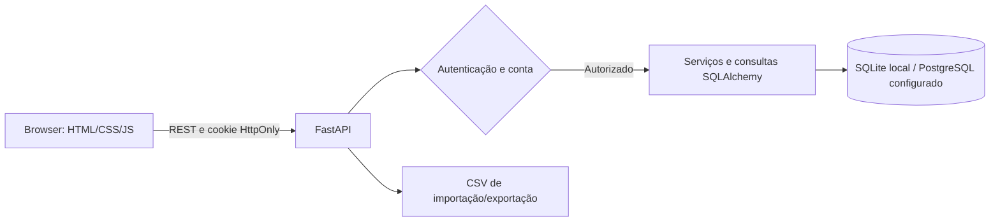

# Arquitetura do FinTrack

## Fluxo

## Entidades

- `User`: identidade; senha armazenada somente como hash Argon2.
- `Account` + `Membership`: separação lógica de espaços financeiros. Nesta versão, o único tipo de membro criado pela API é o proprietário; não existe convite de colaboradores.
- `LoginSession`: token secreto armazenado em hash, expiração, espaço ativo e token CSRF em hash.
- `Category`: categoria de receita ou despesa vinculada a uma conta.
- `Transaction`: lançamento com valor inteiro **em centavos**, tipo, data, categoria e forma de pagamento.
- `Budget`: limite mensal por conta/categoria.
- `Goal` + `GoalContribution`: progresso virtual de metas, independente do livro de lançamentos.
- `RecurringRule` + `RecurringOccurrence`: regras e proteção contra duplicação de ocorrências. O dia original do mês é preservado ao cruzar meses curtos.
- `AuditEvent`: log básico de alterações por espaço; não substitui logs auditáveis de produção.

## Decisões

1. Todos os valores monetários são armazenados em **inteiros de centavos**, evitando erros de aritmética binária de ponto flutuante no banco e na API.
2. Cada consulta com dados financeiros exige o identificador da conta autenticada. Os endpoints validam também a pertença das categorias vinculadas.
3. A sessão é mantida no servidor e entregue via cookie HttpOnly. Requisições de alteração exigem cabeçalho CSRF.
4. O front-end não acessa diretamente o banco; apenas a API fornece dados autorizados.
5. Importação CSV exige prévia e confirmação explícita; exportação protege contra interpretação de fórmulas por editores de planilha.
6. Recorrências são processadas **sob comando explícito do usuário**, e não por tarefas de fundo automáticas. A proteção contra duplicação também existe como restrição de banco.
7. Os indicadores de "saldo" são calculados a partir de lançamentos registrados no app; **não são saldo bancário verificado**.

## Limitações técnicas

- O throttle de login é em memória por processo. Um serviço público exigiria proteção centralizada distribuída.
- O código cria o schema automaticamente para desenvolvimento. Operação em produção precisa de migrações auditadas (por exemplo, Alembic).
- As regras de recorrência e importação devem passar por testes concorrentes em PostgreSQL com múltiplas instâncias.
- Não há integração Open Finance, Open Banking, transferência financeira, pagamentos, 2FA ou recuperação por e-mail.
- Gerenciamento de despesas compartilhadas exige nova modelagem de permissões.
